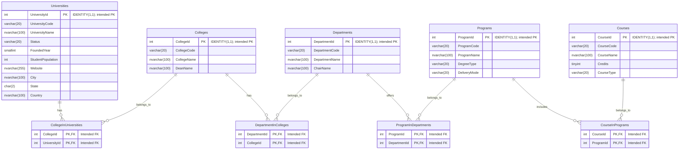

# University Relational Database Best Practice ERD

This logical ERD shows all nine tables from `UniversityRelationalDbBestPractice`.
The four junction tables support many-to-many relationships between universities
and colleges, colleges and departments, departments and programs, and programs
and courses.

**Constraint caveat:** The supplied SQL declares only the composite primary keys
on the junction tables. It does not declare primary keys on the five entity
tables or any foreign keys. The entity `PK` and junction `FK` labels below show
the intended keys, not constraints currently enforced by that SQL.
`IDENTITY(1,1)` alone does not enforce uniqueness.

Each junction row is intended to reference exactly one row in each related entity
table (`||`). Each entity may participate in zero or more junction rows (`o{`).
Each junction's composite primary key prevents duplicate pairs.

All columns are `NOT NULL` in the supplied schema; the identity columns are
implicitly non-nullable. No uniqueness constraints are declared for the code
columns.