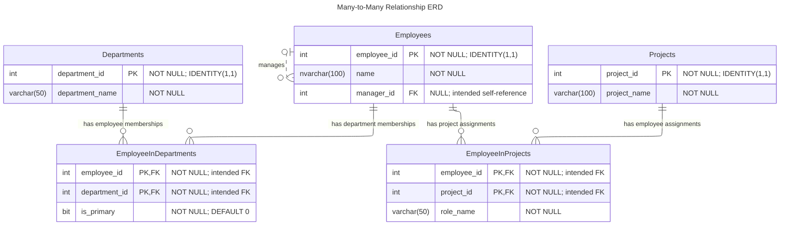

# JoinTypeExamples_ManyToMany ERD

This diagram shows the tables in the `dbo` schema. `PK` identifies primary-key
columns; `FK` identifies intended foreign-key columns. `PK, FK` means a column
is both part of a composite primary key and an intended foreign key.

## Relationship details

- `EmployeeInDepartments` links employees and departments in a many-to-many
  relationship. Its composite primary key is `(employee_id, department_id)`.
- `EmployeeInProjects` links employees and projects in a many-to-many
  relationship. Its composite primary key is `(employee_id, project_id)`.
- Each junction-table row is intended to reference exactly one employee and
  exactly one department or project. An employee, department, or project can
  have zero or more corresponding junction-table rows.
- An employee can have zero or one manager; a manager can manage zero or more
  employees. The manager relationship does not form part of the employee's
  primary key.
- No direct relationship between `Projects` and `Departments` is shown because
  `Projects.department_id` is commented out and is not an actual column.